# 实验1 课程基础与实验环境搭建

## 一 实验目的与任务

本实验建立可复现的Java开发、构建与版本管理环境，明确课程项目的选题、实施范围和交付物。项目选定为租房信息管理系统，产品名称为校园安居，面向学生提供找房、收藏、看房预约和租赁意向管理，面向管理员提供审核、维护和运营统计功能。

## 二 环境检查与技术路线

在本机执行java -version和mvn -version，确认JDK为21.0.12.1，Maven为3.9.16，操作系统为Windows 11。工程以Java 21为编译目标，使用Spring Boot 3.5.7内嵌Tomcat，表现层采用HTML、CSS和原生JavaScript，数据访问使用JdbcTemplate。页面和应用服务均在Windows本机运行，无需单独安装Node前端构建工具或Tomcat服务器。

| 工具或组件 | 本项目配置 | 用途 |
| --- | --- | --- |
| Java | JDK 21 | 编译与运行服务端 |
| Maven | 3.9.16 | 依赖解析、测试、打包 |
| Spring Boot | 3.5.7 | Web服务、内嵌Tomcat和依赖管理 |
| H2 | Maven管理版本 | 本机文件持久化与隔离测试 |
| MySQL及MariaDB驱动 | Maven管理版本 | 连接Kali数据库的可切换配置 |
| JUnit与Spring Test | Maven管理版本 | 规则与业务集成测试 |
| JaCoCo | 0.8.13 | Java测试覆盖率报告 |
| PlantUML | 1.2025.9 | 用例、架构、类、时序、状态及E-R建模 |
| Chrome与Playwright | 本机Chrome及配套运行库 | 页面流程与移动视口验证 |

原需求文档的技术基线为JDK 1.8。本次按实际环境调整为JDK 21；需求编号与核心业务规则保持不变。部署采用Windows本机运行Java、JDBC直连Kali MySQL的结构，目标为192.168.93.128:3306/rental、用户root；Navicat是本机独立管理客户端。常规入口默认mysql，不自动回退H2。修复约10.5秒握手超时后，已连接Kali MariaDB并通过10组浏览器检查；性能数据仍来自隔离H2。

## 三 工程建立与最小运行

工程根目录包含pom.xml、src/main/java、src/main/resources、src/test/java、scripts和docs。首次运行时自动建表、检查索引并按demo模式导入演示数据。代码包中提供可运行JAR和Windows启动脚本，源代码可用Maven重新编译。

```text
java -version
mvn -version
mvn -B -ntp verify
java -Dfile.encoding=UTF-8 -jar dist/rental-hub-1.0.0.jar
浏览器访问 http://127.0.0.1:8080
```

基础Java入口沿用先验证工具链再建立工程的思路。下面给出最小Hello World代码用于说明JDK验证方法；正式项目入口是RentalApplication.main。

```java
public class HelloWorld {
    public static void main(String[] args) {
        System.out.println("Hello World!");
    }
}
```

## 四 课程设计流程与个人学习目标

学习目标是把需求编号、设计模型、业务代码和测试用例连成可追踪的链条。实现过程中重点练习参数化SQL、事务边界、对象归属检查、状态机、数据库约束和缺陷回归；文档部分保留需求分析和设计依据，避免只有界面截图而没有实现说明。

| 课程计划阶段 | 周次 | 阶段产物 |
| --- | --- | --- |
| 问题定义与环境准备 | 第1周 | 选题、工具链、最小程序 |
| 需求获取与需求规格化 | 第2至3周 | 模拟调研、FR与NFR清单、SRS |
| 概要设计 | 第4周 | 系统结构、模块接口、部署方案 |
| 详细设计 | 第5至7周 | UML、数据字典、约束与流程 |
| 编码与联调 | 第8至10周 | 可运行系统、单元与集成用例 |
| 测试与交付 | 第11至12周 | 测试证据、用户手册、报告归档 |

## 五 实验结果与总结

工具链能够编译Java 21工程，应用可在本机启动并访问中文房源页面。本项目采用原创业务实现，参考Spring官方文档与Spring PetClinic的分层示例进行技术选型，未复制租房项目代码或冒充已有项目的二次开发。依赖通过Maven声明；没有把第三方二进制工具直接当作应用源代码。

本实验的主要认识是运行环境属于需求的一部分。构建目标、数据库位置和启动方式需要尽早统一；同一份业务代码提供独立演示配置，可以在远程依赖不可用时继续验证核心流程。

# 实验2 需求分析

## 一 实验目的与资料来源

依据《租房信息管理系统 软件需求规格说明书》V1.0和已有实验1、2记录，识别用户角色、业务边界、功能约束和非功能要求。需求调研采用课程中的问卷与访谈模拟方法；以下问题用于需求分析推演，不将模拟过程描述为实际发放问卷或已获得统计样本。

## 二 角色与需求获取

学生关注找房效率、房源真实性、价格和位置，并希望随时查看预约与咨询进展。管理员关注房源与评价审核、学生认证、预约状态和运营数据。房东保留为后续扩展，本期由管理员代理录入房源，不开放学生发布房源。

| 模拟对象 | 关键问题 | 转化出的可验证规则 |
| --- | --- | --- |
| 学生 | 如何快速找到预算内房源 | 按区域、户型、租金、面积和关键字组合筛选 |
| 学生 | 同一时间有人预约怎么办 | 显示可用时段，冲突预约返回409 |
| 学生 | 谁可以看到个人记录 | 收藏、预约、咨询、合同和认证材料按本人隔离 |
| 管理员 | 怎样避免未核验房源展示 | 新增待审，审核通过后才上架；修改后重审 |
| 管理员 | 怎样保证评价可信 | 已完成看房或签约才可评价，审核后公开 |
| 管理员 | 需要查看哪些统计 | 在库房源、注册学生、预约量与有效签约量 |

## 三 功能需求及实现跟踪

本期覆盖FR-01至FR-17。表中以实现位置和验证点建立跟踪，不重新编号原需求。

| 编号 | 功能 | 主要实现 | 验证重点 |
| --- | --- | --- | --- |
| FR-01 | 注册登录与恢复 | AuthController | 学生角色固定、验证码、密码散列、限流、恢复密钥 |
| FR-02 | 资料与学生认证 | AuthController UploadController | 本人资料、图片格式、私有材料、管理员审核 |
| FR-03 | 房源浏览 | HouseController | 仅已审核上架房源可公开查看 |
| FR-04 | 搜索筛选排序 | HouseController | 组合条件、区间边界、分页、排序白名单 |
| FR-05 | 收藏管理 | HouseController | 本人数据、重复收藏、取消收藏 |
| FR-06 | 预约看房 | StudentController ReservationService | 时段可用性、并发唯一占位、本人取消 |
| FR-07 | 在线咨询 | StudentController AdminController | 私有留言、管理员回复、文字安全输出 |
| FR-08 | 合同与租赁意向 | StudentController AdminController | 模板、看房资格、意向确认、租期冲突 |
| FR-09 | 评价反馈 | StudentController AdminController | 看房或签约资格、先审后显、驳回重提 |
| FR-10 | 房源代理录入 | AdminController | 仅管理员、字段校验、初始待审 |
| FR-11 | 房源审核 | AdminController | 审核状态、人、时间及意见 |
| FR-12 | 房源维护 | AdminController | 修改重审、上下架、关联保护与逻辑删除 |
| FR-13 | 用户与认证审核 | AdminController | 禁用解禁、会话版本失效、材料审核 |
| FR-14 | 公告管理 | AdminController HouseController | 新增修改删除及首页展示 |
| FR-15 | 预约管理 | AdminController ReservationService | 确认、完成、取消及非法状态拒绝 |
| FR-16 | 运营统计 | AdminController | 区域、户型、日期筛选与统计口径 |
| FR-17 | 基础字典 | AdminController | 区域户型租金区间、编辑同步、引用保护 |

## 四 非功能需求与验收口径

| 编号 | 要求 | 实现或验证方式 | 本次结论边界 |
| --- | --- | --- | --- |
| NFR-01 | 响应及并发性能 | 独立10万条数据、100并发HTTP请求 | 仅覆盖本机H2环境与指定查询 |
| NFR-02 | 中文界面与易用性 | 侧栏入口、详情预约、日期选择、错误提示 | 核心入口通常在3次点击内可达，未做用户研究 |
| NFR-03 | 认证授权和隐私 | BCrypt、会话、CSRF、参数化SQL、文字转义 | 完成自动化安全边界测试 |
| NFR-04 | 可用性与备份 | 每日02点本机备份、手动备份、隔离恢复 | 已测试备份恢复；99%长期可用性未测定 |
| NFR-05 | 可维护性 | 分层类、规则封装、源码和测试 | 可重新构建，有设计和接口说明 |
| NFR-06 | 可扩展性 | 多数据库profile、明确模块边界 | 房东、支付、地图和征信留作后续设计 |
| NFR-07 | 兼容性 | Chrome桌面与390像素手机视口 | 未声明已完成其他浏览器和系统矩阵测试 |
| NFR-08 | 先审后发与可追溯 | 房源和评价审核、审计表、材料访问控制 | 核心业务规则有对应自动化验证 |

## 五 待定项的本期实现约定

为完成可运行版本，对待定项采用明确的工程约定：Web形态、学生及管理员两类角色、文件本地存储；密码至少6位且含字母数字，BCrypt输入不超过72字节；学生账号为6至20位数字；预约时间为未来30天内09至18点整点；评分1至5星；文字评价和咨询上限1000字符；图片只接收PNG与JPEG且不超过5MB及2000万像素。

密码找回使用注册时一次性展示的随机恢复密钥，不接入短信服务。连续5次失败后限制15分钟。房源修改后重新审核；删除采用逻辑删除，并拒绝删除仍有活跃预约或有效合同的房源。合同记录是租赁意向和线下签约状态跟踪，不包含电子签章和在线支付。上述约定是本期实现选择，未伪称已获得需求方正式评审批准。

## 六 实验总结

需求分析不能只写“支持预约”“保证安全”。通过给出参与者、前置条件、输入范围、状态转移和异常结果，才能据此设计数据库约束和测试。原文档仍待确定的性能下降阈值、备份保留期和长期可用性统计周期，应继续保留其待确认属性。

# 实验3 UML建模

## 一 实验目的与建模工具

用UML表达角色、系统边界和核心用例，避免把页面菜单直接等同于业务模型。采用PlantUML保存可编辑的.puml源文件，并通过Java命令生成PNG。图形源文件与图片一同交付，后续修改需求时可重新生成。

```text
java -jar plantuml-1.2025.9.jar -charset UTF-8 -tpng docs/diagrams/*.puml
```

## 二 学生端用例图

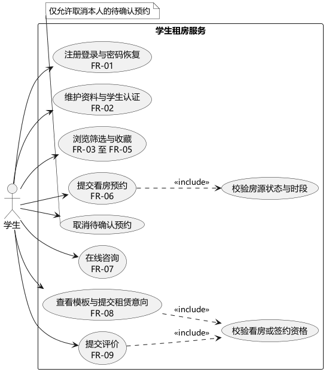

学生是前台业务的直接参与者。注册登录、资料、浏览收藏、预约、咨询、合同和评价均在系统边界内。提交预约必须包含房源状态和时段校验，因此使用include关系；评价与租赁意向依赖既有看房或签约资格，由资格检查用例表达。取消预约具有单独入口和前置条件，不将所有取消行为误画为正常提交的必经步骤。

## 三 管理端用例图

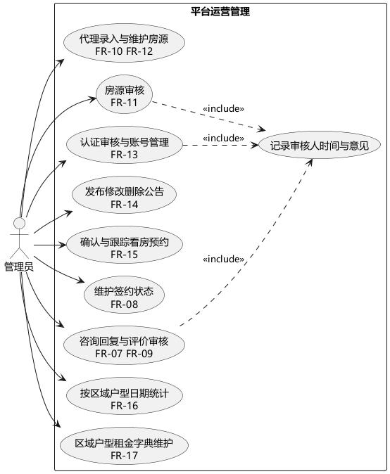

管理员录入与维护房源，审核学生认证、房源和评价，跟踪预约及签约，维护公告、统计和字典。审核操作包含可追溯记录，保存执行人、时间、对象和意见。管理员不是学生的继承角色；其管理权限由角色校验决定。房东角色未启用，因此没有把不存在的房东入口画成本期交付功能。

## 四 核心用例描述

用例UC-RESERVE-01为提交看房预约，关联FR-06。参与者为已登录学生，前置条件为房源已上架、选定日期在未来30天内。学生选择日期，系统列出可用整点时段；学生填写手机号后提交。后端检查会话、角色、输入范围、房源状态及占位约束，成功后生成待确认预约并记录审计。

备选流程包括未登录引导登录、输入不合规返回400、房源下架拒绝预约、并发占用返回409。成功后预约属于当前学生；失败不应留下部分预约或孤立审计记录。学生可取消自己的待确认预约，管理员可确认、完成或取消，但已取消或已完成状态不能随意回退。

用例UC-HOUSE-REVIEW-01为房源审核，关联FR-11。管理员进入待审列表，核验信息，填写审核意见。通过后房源上架，驳回后保留驳回原因。若房源不在待审状态，系统拒绝重复审核。修改已上架房源后，重新进入待审状态，避免修改内容绕过审核直接公开。

用例UC-COMMENT-01为提交评价，关联FR-09。学生需完成看房或签约，评分在1至5之间。评价初始为待审，管理员通过后公开展示。每位学生对每套房源最多保留一条评价，驳回后允许修改重提。公开评价显示姓名首字和“同学”，不展示账号与手机号。

## 五 模型检查与实验总结

检查两张用例图是否均有参与者和系统边界，include箭头是否指向被包含用例，是否遗漏主要FR编号，是否把实现细节错误地作为外部参与者。用例图负责说明谁与系统交互；具体调用顺序和数据关系分别在时序图、类图与E-R图中细化。

# 实验4 系统概要设计

## 一 设计目标

系统采用表现层、业务层和数据访问层的分层设计，以本机可部署、核心规则可测试、模块边界可理解为目标。单体应用适合当前课程规模，统一提供静态页面和JSON接口，避免为小型系统引入独立前端服务、消息队列和分布式部署依赖。

## 二 总体结构与部署

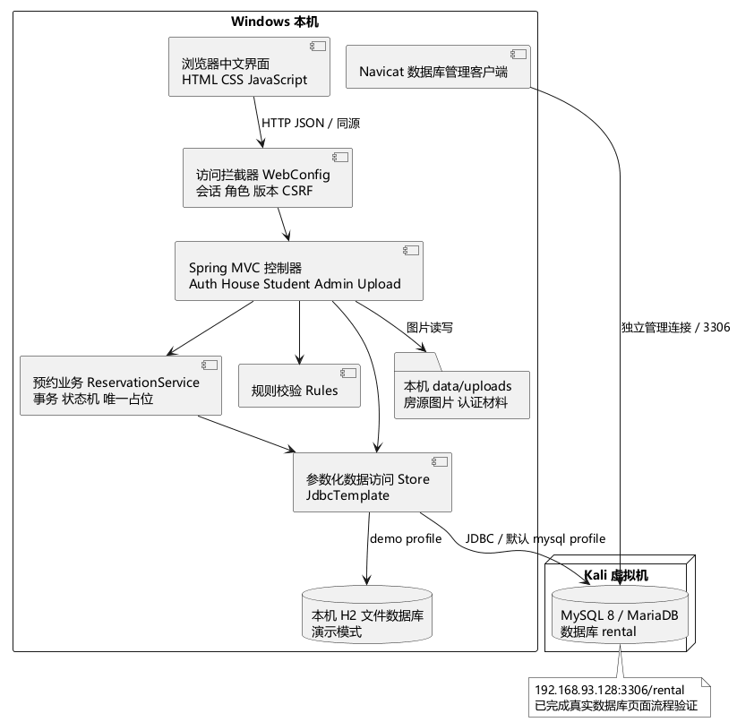

浏览器与本机Tomcat通过同源HTTP交互。WebConfig在接口进入控制器前执行CSRF与角色检查，并重新读取账号状态和会话版本。控制器校验业务输入、调用预约服务或数据访问方法；Store集中封装参数化JDBC查询。默认mysql配置通过JDBC连接Kali；显式demo配置才使用本机H2文件数据库，切换不改变页面地址。

本次应用默认只监听127.0.0.1，适合本机实验。若将来向局域网开放，应明确设置SERVER_ADDRESS、使用HTTPS、替换演示账号并审查部署环境，不能直接把本机演示配置当成公共生产环境。

## 三 模块划分与依赖

| 模块 | 主要类或资源 | 责任与依赖 |
| --- | --- | --- |
| 用户与权限 | AuthController WebConfig | 账号、恢复、资料、会话及角色授权 |
| 房源与检索 | HouseController AdminController | 公开搜索、详情、收藏和后台房源生命周期 |
| 预约业务 | StudentController ReservationService | 前台提交、状态机、事务及管理员跟踪 |
| 合同与反馈 | StudentController AdminController | 意向与签约记录、咨询回复及评价审核 |
| 文件与认证 | UploadController | 图片解码重编码、公开房源图、私有认证材料 |
| 数据与初始化 | Store Bootstrap schema.sql | SQL参数绑定、索引、初始账号及示例数据 |
| 备份 | BackupService scripts | H2在线快照及上传文件归档、MySQL备份步骤 |
| 表现层 | app.js app.css index.html | 中文界面、路由、表单、图表和响应式布局 |

模块依赖方向为页面到控制器、控制器到业务或数据访问、预约业务到Store。Store不反向调用页面或控制器。事务集中在需要多步一致性的业务方法，尤其是预约占位、审核、合同状态及字典引用同步。基础输入规则集中在Rules，避免同一字段在不同接口使用相互矛盾的校验。

## 四 主要模块接口

| 接口 | 输入 | 输出或约束 |
| --- | --- | --- |
| GET /api/session | 会话Cookie | 当前用户及CSRF令牌 |
| GET /api/houses | 关键字、区间、排序、分页 | 已上架房源及总数 |
| GET /api/houses/{id}/availability | 日期 | 当日整点时段与可用性 |
| POST /api/reservations | 房源、看房时刻、手机号 | 待确认预约或400及409提示 |
| PUT /api/admin/reservations/{id}/status | 目标状态 | 经状态机验证后的更新结果 |
| POST /api/contracts | 房源、租期、二次确认 | 本人租赁意向 |
| PUT /api/admin/houses/{id}/review | 结论和意见 | 审核结果与审计 |
| POST /api/me/certification | Multipart图片 | 私有材料和待审认证状态 |
| GET /api/admin/stats | 区域、户型、起止日期 | 汇总、区域分布与预约日期分布 |
| POST /api/admin/backups | 管理员会话与CSRF | 本机数据库及文件备份结果 |

## 五 错误处理和日志

接口统一返回JSON。输入问题返回400，未登录返回401，无角色权限或CSRF验证失败返回403，不可访问记录返回404，唯一约束冲突返回409，登录限流返回429。未预期异常返回503及“系统繁忙，请稍后重试”，不会向浏览器输出SQL、密码散列、恢复密钥或认证材料路径。

Hikari连接池控制连接数量、连接超时及后台恢复连接。对于可能已提交的写操作，不通过无条件自动重试制造重复业务记录。应用日志滚动保留30天、单文件上限10MB；审计表保存关键业务动作。故障定位依靠异常类别和业务审计，日志不记录明文密码和认证图片内容。

## 六 实验总结

概要设计的关键是依赖方向和事务职责，而不是组件数量。当前结构能够覆盖本期业务，同时保留数据库配置和模块拆分空间。后续房东角色、短信、地图或电子签章应通过新用例、接口和测试扩展，不能仅增加一个菜单就宣称已经实现。

# 实验5 系统详细设计

## 一 核心类与对象关系

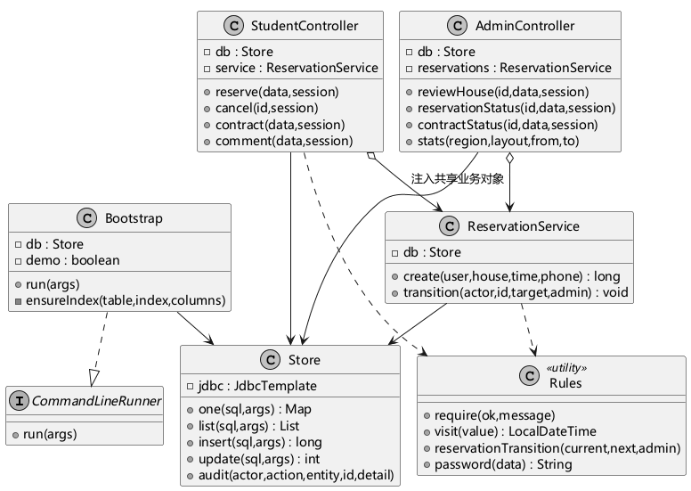

StudentController接收学生提交，AdminController接收后台状态更新，两者共享注入的ReservationService。服务使用Store完成数据库操作，通过Rules校验状态机和业务约束。Bootstrap实现CommandLineRunner接口，在应用启动后补齐字典、初始账号和索引。图中保留实际存在的接口实现关系，未人为增加没有代码依据的继承层次。

## 二 预约时序与并发控制

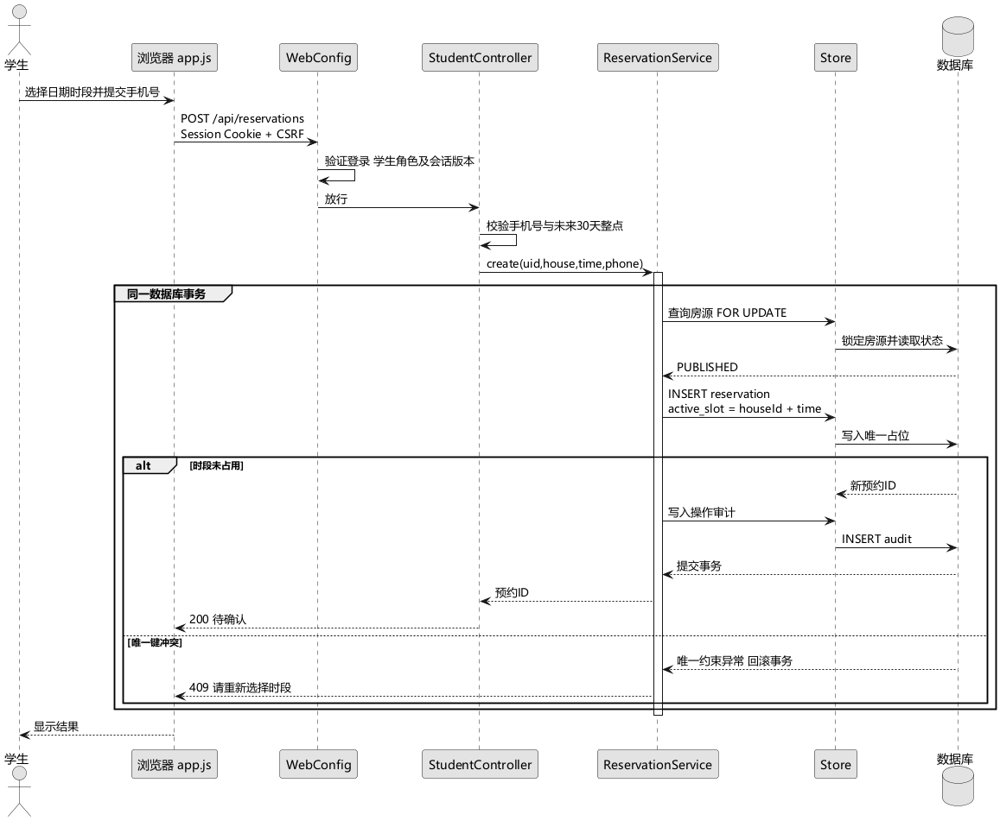

在事务内先锁定房源记录并验证上架状态，再插入预约和审计。active_slot保存房源编号与标准化看房时刻的组合，数据库唯一索引限制同一房源同时段只有一条有效预约。取消时将active_slot设为NULL，利用MySQL和H2唯一约束允许多个NULL的语义释放占位，同时保留取消历史。

状态更新先对预约执行FOR UPDATE，随后验证归属和允许的转换，再同时更新状态、占位与审计。管理员权限不代表可以任意回退状态。已完成看房和已取消记录保持终态，避免重复确认或撤销已经产生的后续业务资格。

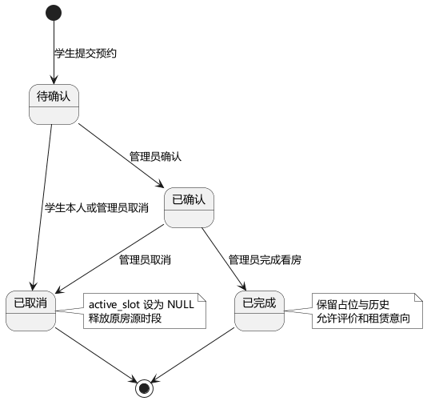

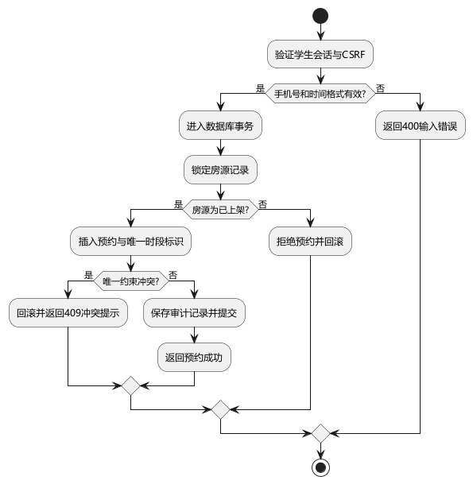

## 三 数据库概念与逻辑设计

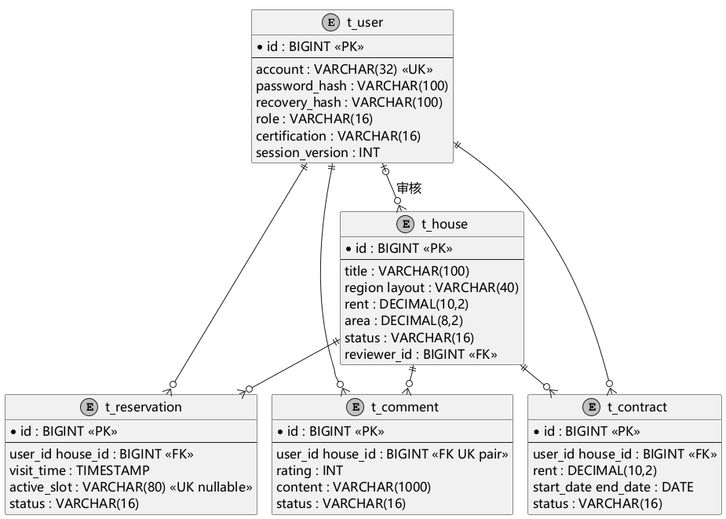

以用户、房源、预约、合同、评价为核心实体，收藏是用户与房源之间的多对多关联表，留言和公告单独建表，审计与基础字典独立维护。每张主实体表以单列自增主键标识记录；账号唯一、收藏复合主键、评价的用户房源组合唯一、预约有效时段唯一。外键保护用户与房源业务关联。

| 表名 | 主键与关键约束 | 主要字段及含义 |
| --- | --- | --- |
| t_user | id；account唯一 | 散列密码及恢复密钥、姓名、角色、学校、手机号、认证、启用状态、会话版本 |
| t_house | id；reviewer_id外键 | 标题、区域地址、租金面积、户型设施、图片、提供者、状态、审核信息 |
| t_reservation | id；active_slot唯一 | 学生与房源外键、预约时间、联系方式、预约状态、创建时间 |
| t_contract | id；学生与房源外键 | 月租快照、租期起止、意向或签约状态、条款、签约时间 |
| t_comment | id；用户房源组合唯一 | 评分、文字、审核状态及意见、创建时间 |
| t_favorite | user_id与house_id复合主键 | 本人收藏关系与收藏时间 |
| t_message | id；学生房源及回复人外键 | 留言、回复、回复人和回复时间 |
| t_notice | id；publisher_id外键 | 标题、内容、发布人及发布时间 |
| t_dictionary | id；category与label组合唯一 | 区域户型条目、租金区间上下限 |
| t_audit | id；actor_id外键 | 动作、对象类型与编号、说明、操作时间 |

用户和房源信息不在预约表重复存储，列表通过关联查询显示姓名与标题；合同月租是签约时的业务快照，后续房源调价不会改写已提交合同。区域和户型在本版本使用字典标签值，引用检查和更名同步由事务实现，未宣称其具有数据库物理外键。可进一步改成region_id和layout_id，以强化数据库层引用完整性。

## 四 物理字段范围与索引

| 字段 | 类型与范围 | 校验与设计理由 |
| --- | --- | --- |
| rent | DECIMAL(10,2)，0.01至999999.99元 | 金额使用十进制，避免浮点误差 |
| area | DECIMAL(8,2)，0.01至9999.99平方米 | 精度2位，前后端均校验 |
| rating | INT，1至5 | 服务校验及CHECK约束 |
| account | VARCHAR(32) | 学生输入限制6至20位数字；管理员单独初始化 |
| password_hash | VARCHAR(100) | 保存BCrypt散列，不保存明文 |
| visit_time | TIMESTAMP | 未来30天内，09至18点整点 |
| status | VARCHAR(16) | 业务白名单校验，不接收任意状态 |
| content | 评价留言1000字符；公告2000字符 | 控制存储长度和页面显示 |
| 图片 | PNG或JPEG | 5MB、2000万像素上限、解码后重新编码 |

房源检索索引为status、region、layout、rent、id；预约按user_id和status建立索引；合同按house_id、status、start_date和end_date建立索引。关键字包含匹配的LIKE查询不保证完整使用B树索引，后续规模增加时应评估全文检索；本次性能测试采用明确的区域户型和租金条件。

## 五 合同与隐私细节

提交租赁意向前校验本人已完成看房、房源可用、租期合法、条款确认以及无重复有效意向。管理员记录签约时，对房源加锁并检查已签约记录是否与新租期重叠。已签约可终止，未处理意向可取消。合同不具备第三方电子签章能力，报告和界面均明确其边界。

公开房东手机号仅显示前三后四；个人认证材料通过受控接口读取，路径不暴露为静态资源。密码重置和账号禁用增加session_version，使旧会话在下次请求时失效。房源、留言、评价和公告文本经前端HTML转义后插入页面，上传图片重新编码并配合内容安全策略，降低脚本注入风险。

## 六 实验总结

详细设计需要把时序、状态和数据库约束互相核对。单靠“先查询是否已有预约”不能解决并发竞争；只有结合唯一约束和事务回滚，才能确保重复请求不会产生两条有效占位。对已取消记录保留历史，同时释放时段，是本项目数据模型的一个关键取舍。

# 实验6 编码规范与模块化编程

## 一 实验目的与编码约定

按照概要与详细设计实现完整系统，并重点说明预约模块。Java使用PascalCase类名、camelCase方法名、UPPER_SNAKE_CASE常量；源文件采用UTF-8，通过Google Java Format统一排版。控制器处理HTTP与输入转换，服务处理跨步骤事务，Store处理参数绑定，Rules处理可复用规则。

目录、构建、启动、测试、账号和数据库切换均写入README。运行数据、日志、临时工具、数据库密码与本地配置不纳入Git和公开压缩包；上传目录由程序创建。前端使用统一api函数处理Cookie、CSRF、JSON和错误，避免不同页面重复拼接请求逻辑。

## 二 预约模块核心代码

以下代码直接摘自本项目ReservationService，体现房源锁、数据库唯一占位和审计同事务提交。

```java
@Transactional
  public long create(long user, long house, LocalDateTime time, String phone) {
    var h = db.one("SELECT id,status FROM t_house WHERE id=? FOR UPDATE", house);
    require("PUBLISHED".equals(h.get("status")), "房源当前不可预约");
    long id =
        db.insert(
            "INSERT INTO t_reservation(user_id,house_id,visit_time,phone,active_slot) VALUES"
                + " (?,?,?,?,?)",
            user,
            house,
            time,
            phone,
            house + ":" + time);
    db.audit(user, "RESERVE", "RESERVATION", id, "提交看房预约");
    return id;
  }
```

控制器在进入服务前验证学生角色、手机号、日期范围与整点粒度。服务中的事务方法由Spring代理调用，发生唯一约束异常时整体回滚。错误处理器把该异常映射为409和重新选择时段的提示。取消方法只允许学生取消自己的待确认预约；管理员也必须遵循状态机。

## 三 模块接口调用与运行结果

页面选择可用时段后调用POST /api/reservations；StudentController调用ReservationService.create；服务通过Store绑定SQL参数；响应返回预约编号。学生“看房预约”页面读取本人数据，管理员“预约管理”页面读取全局记录并执行状态变更。页面之间共享业务记录而不依赖手工复制数据。


界面提供统一侧栏、组合筛选、分页、空结果提示、日期与时间选择、审核状态标签和二次确认。示例房源使用本项目本地矢量插图，标明配图仅供参考，不能作为真实房源照片使用。管理员可上传PNG或JPEG房源照片替换示例图。

## 四 安全和异常处理实现

密码使用BCrypt散列；注册接口固定创建学生，不采用客户端传入的role。会话登录后更换ID并更新CSRF令牌；初始页面先建立会话，再读取其他依赖会话的数据，防止并发初始化创建两个不同会话。删除、下架和签约均在页面侧二次确认，后端仍独立校验权限和业务状态。

恢复密钥在注册或重置时展示一次，数据库仅保存其BCrypt散列，重置后旧密钥失效。学生认证图片使用随机文件名，检查真实格式和像素数并重新编码；仅本人及管理员能查看。原始文件名不参与目标路径计算，避免目录穿越。

## 五 实验结果与总结

系统已完成页面、接口与数据库的联通。预约模块可独立验证规则与事务；主键返回、统计别名和首次会话问题均已修复，并经过回归验证。

# 实验7 版本控制与团队协作

## 一 实验目的与模拟边界

掌握分支开发、合并、冲突定位与处理，并保留可复查历史。本项目由个人完成，团队流程通过独立本地Git仓库模拟；origin是本地裸仓库。没有虚构多人协作、GitHub账号注册、远程公开仓库或已发布的GitHub Issues。

## 二 分支策略与协作规范

master作为演示发布分支，dev作为集成分支，feature/reservation和feature/review分别模拟预约与审核需求的开发。功能完成后先检查输入和权限测试，再合并到dev；集成验证通过后以非快进方式合并到master，使提交图保留功能分支边界。

提交信息采用feat、fix、test、docs和chore前缀。每次提交应围绕一个可解释的变化，不提交密码、运行库文件或随机生成的数据。代码审查重点为角色与数据归属、事务范围、状态变化、参数化SQL和测试；文档必须与实际接口一致。若真实团队协作，应在推送前同步远程变化，并通过受控合并请求审阅。

## 三 本地分支与推送操作

```text
git init --bare git-lab-remote.git
git init -b master git-collaboration
git switch -c dev
git switch -c feature/reservation
git commit -am "feat: add confirmed reservation state"
git switch dev
git switch -c feature/review
git commit -am "feat: describe reviewed reservation state"
git switch dev
git merge --no-ff feature/reservation
git merge --no-ff feature/review
```

两个feature分支修改workflow.txt同一行，使第二次合并产生真实文本冲突。保留冲突输出和git status中的未合并状态后，根据业务含义解决：预约使用PENDING、CONFIRMED、COMPLETED；评价审核使用PENDING、APPROVED、REJECTED，二者不应混为同一状态字段。

```text
reservation_status=PENDING -> CONFIRMED -> COMPLETED
review_status=PENDING -> APPROVED or REJECTED
git add workflow.txt
git commit -m "fix: distinguish reservation and review state machines"
git switch master
git merge --no-ff dev
git push -u origin master dev feature/reservation feature/review
```

## 四 历史证据与可复现资料

```text
*   6590c95 (HEAD -> master) release: finish local collaboration simulation
|\  
| *   999b0db (dev) fix: distinguish reservation and review state machines
| |\  
| | * 9f6e1f2 (feature/review) feat: describe reviewed reservation state
| |/  
|/|   
| * 278a48e merge: integrate reservation workflow
|/| 
| * 259a6eb (feature/reservation) feat: add confirmed reservation state
|/  
* bbaa996 chore: initialize local collaboration exercise
```

完整输出保存在docs/evidence/git-collaboration.txt，包含冲突、冲突状态、解决后的内容和提交图；collaboration-lab.bundle包含各分支实际历史，可使用git clone collaboration-lab.bundle复查。本地模拟仓库的提交身份为Course Lab，未伪造同学身份或远程协作记录。

## 五 实验总结

解决冲突需要理解修改所表达的业务含义。本例将预约与审核拆成独立状态机，并保存分支、冲突、合并和本地推送的真实历史。

# 实验8 单元测试

## 一 实验目的与测试策略

使用JUnit 5为基础规则和预约业务建立正常、异常与边界测试，再用JaCoCo检查覆盖情况。RulesTest对密码、手机号、日期、金额、文本和状态转换进行参数化测试；WorkflowTest通过Spring MockMvc加载完整Web上下文，验证权限、事务和数据约束；PerformanceTest使用独立内存数据库进行指定负载测试。

## 二 规则单元测试设计

| 用例组 | 正常输入 | 异常或边界 | 预期 |
| --- | --- | --- | --- |
| 密码 | abc123、Student123! | 纯数字、纯字母、过短、无拉丁字母 | 合法通过，非法返回业务异常 |
| 手机号 | 13800138000、19912345678 | 位数错误、非法号段、含字母 | 只接受合法11位号码 |
| 预约时间 | 未来2天10点整 | 过去、半点、超过30天、格式错误 | 按日期与粒度拒绝异常 |
| 金额 | 123.45 | 零、负数、超上限、三位小数、NaN | 保持十进制与2位精度 |
| 预约状态 | 待确认到确认、确认到完成 | 学生取消已确认、终态回退、越级完成 | 只允许明确的状态转换 |
| 文本 | 范围内字符串 | 空文本与空字符 | 清理首尾前识别非法空字符 |

RulesTest的参数化输入展开后共35项。对预约并发的测试同时释放12个线程提交同一房源同一时段，要求1个成功、11个唯一约束冲突，数据库最终只有1条有效预约。该测试验证数据库约束和事务，不以串行调用替代并发验证。

## 三 测试代码与运行命令

```java
@Test
void rejectsPast() {
    assertThrows(ResponseStatusException.class,
        () -> Rules.visit(LocalDateTime.now().minusDays(1).toString()));
}
```

```text
mvn -B -ntp verify
单元与集成结果 target/surefire-reports
覆盖率网页 target/site/jacoco/index.html
```

## 四 实测结果与覆盖率

| 测试组 | 用例数 | 失败 | 错误 | 耗时 秒 |
| --- | --- | --- | --- | --- |
| PerformanceTest | 1 | 0 | 0 | 8.286 |
| RulesTest | 35 | 0 | 0 | 0.117 |
| WorkflowTest | 28 | 0 | 0 | 4.735 |

本轮共64项通过，失败0，错误0，跳过0。原始结果归档于docs/test-reports/surefire。

| 覆盖范围 | 行覆盖率 | 分支覆盖率 |
| --- | --- | --- |
| 全部Java应用代码 | 84.54% | 57.80% |
| Rules | 95.74% | 82.76% |
| ReservationService | 100.00% | 100.00% |


覆盖率以实际JaCoCo XML为依据，行覆盖率和分支覆盖率分别报告，不将行覆盖率误写成所有分支已经覆盖。ReservationService的核心事务方法与状态更新路径在本轮报告中单独列示。应用入口、异常兜底、部分文件读写错误和真实MySQL故障场景仍有未覆盖部分。

## 五 缺陷定位和回归

| 缺陷 | 发现方式 | 原因 | 修复与回归 |
| --- | --- | --- | --- |
| NUL文本未被拒绝 | 规则单元测试 | trim先移除了末尾控制字符 | 在trim前检查原始字符串并保留回归用例 |
| 启动阶段读取数据源为空 | 上下文测试 | 对Spring代理对象直接访问字段 | 通过Store方法获取真实数据源 |
| H2返回多生成字段 | 初始化测试 | getKey假定只有一个返回列 | PreparedStatement明确请求id列 |
| 统计查询兼容性异常 | 集成测试 | 采用容易与方言关键字冲突的day别名 | 改为visit_day并回归统计接口 |
| 备份测试失败 | 备份用例 | H2内存库不支持文件备份语义 | 业务集成使用独立文件库，压测仍使用隔离内存库 |

本轮采用先实现后补充与完善测试的过程，没有把整个开发过程描述成完整测试驱动开发。对于修复项，先保留能够复现失败的用例，再修改实现并执行回归，体现了测试先于修复的局部实践。

## 六 实验总结

测试应验证越权被拒绝、取消释放时段和冲突只有一个胜者，而不仅检查方法调用。覆盖率帮助寻找盲点，不能替代业务断言；未测试环境必须明确标注。

# 实验9 集成测试

## 一 集成范围与测试环境

集成测试覆盖浏览器、HTTP控制器、会话拦截、预约服务、JDBC及数据库，重点检查多个模块共同完成的业务。自动化Web测试使用独立H2文件库，压测使用独立H2内存库；真实浏览器验收已在Kali MariaDB服务上重跑。全部实测在2026年10月24日执行，未以模板中未来的课程计划日期冒充执行日期。

## 二 业务集成用例

| 编号 | 交互场景 | 预期结果 |
| --- | --- | --- |
| IT-01 | 未登录及学生调用后台接口 | 分别返回401与403 |
| IT-02 | 缺少CSRF提交收藏或写操作 | 拒绝请求且不改数据 |
| IT-03 | 新建房源到审核公开 | 待审不可见，通过后可见，编辑后再次隐藏 |
| IT-04 | 收藏新增重复取消 | 关系唯一，取消只影响本人 |
| IT-05 | 预约提交到取消再预约 | 重复时段冲突；取消后释放占位 |
| IT-06 | 管理员确认与完成看房 | 合法状态逐步推进，禁止越级完成 |
| IT-07 | 看房完成到评价审核 | 无资格拒绝；待审不公开，通过才展示 |
| IT-08 | 咨询提交到管理员回复 | 学生看到本人问题及对应回复 |
| IT-09 | 看房到租赁意向再签约 | 保存月租快照，防重复意向，跟踪签约终止 |
| IT-10 | 公告增改删与前台读取 | 内容一致，文本不以脚本执行 |
| IT-11 | 字典维护及被引用条目删除 | 新增未引用条目可删除，引用条目受保护 |
| IT-12 | 注册后密钥恢复 | 客户端不能提权，重置后旧会话失效 |
| IT-13 | 学生材料上传与认证审核 | 只接受真实图片，材料受控，状态正确变化 |
| IT-14 | 统计条件与操作审计 | 有汇总数据，反向日期区间拒绝 |
| IT-15 | 在线备份与隔离恢复 | 备份含数据库，恢复后关键记录可查询 |

## 三 浏览器流程验证

| 浏览器检查组 | 结果 |
| --- | --- |
| 房源首页及本地插图 | PASS |
| 搜索与空结果 | PASS |
| 学生登录 | PASS |
| 房源详情与预约表单 | PASS |
| 学生个人页面 | PASS |
| 学生越权阻止 | PASS |
| 管理员登录及统计 | PASS |
| 管理端全部功能入口 | PASS |
| 房源录入表单与图片 | PASS |
| 移动端首页无横向溢出 | PASS |

本轮页面脚本异常0项。另通过真实HTTP请求完成字典新增、编辑、删除以及可用时段查询，结果见supplementary.json。

浏览器使用独立无头Chrome配置，不读取用户的常用浏览器资料。脚本检查首页、无结果搜索、学生登录、预约表单、个人页面、越权页面、管理员统计和全部管理入口，并在390×844视口检查文档宽度不超过窗口。截图先等待图片实际加载完成，再保存证据，避免把尚未加载的房源图当成界面最终状态。

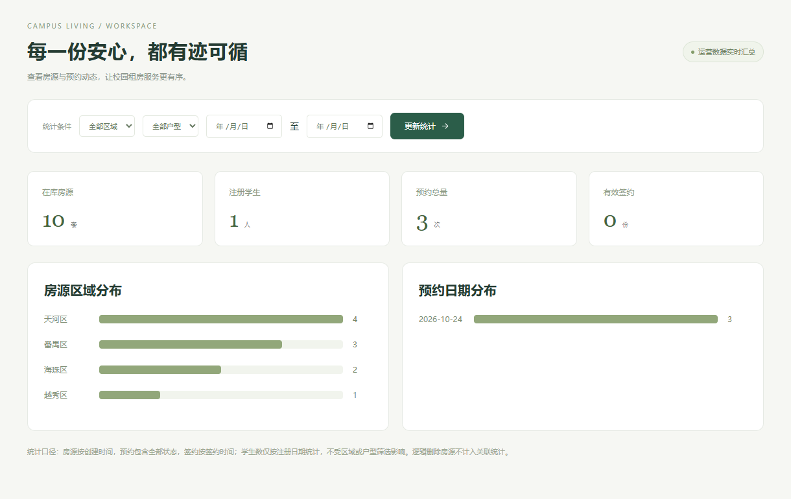

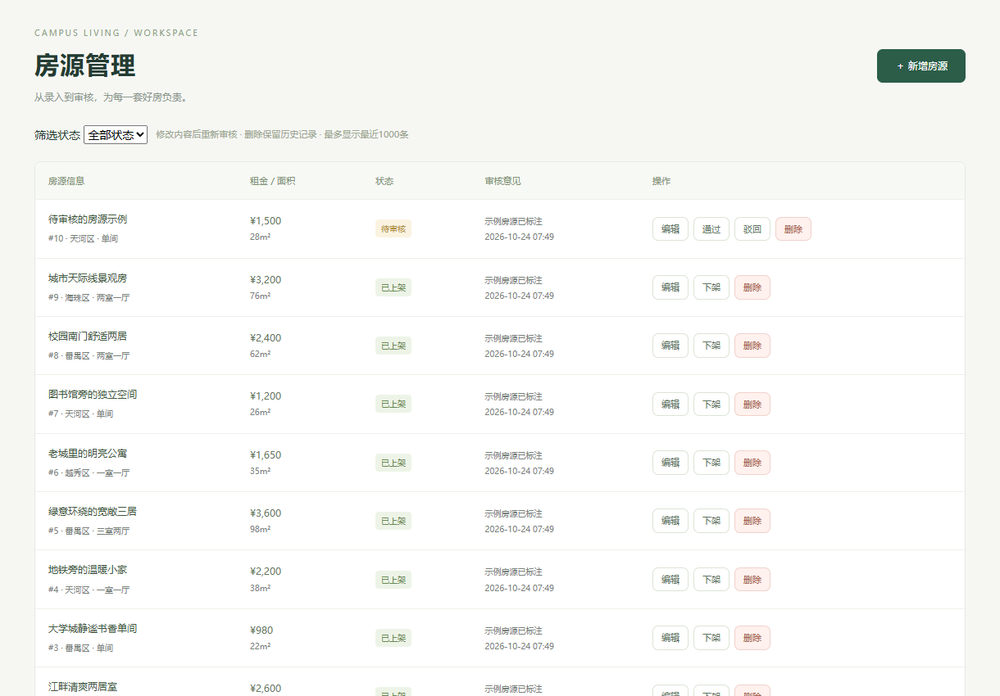

## 四 性能实测

| 负载 | 数据量或请求数 | 实测值 |
| --- | --- | --- |
| 基线串行查询P95 | 1010条，20次 | 5.41 ms |
| 大数据串行查询P95 | 100000条，20次 | 3.77 ms |
| 并发查询P95 | 100并发，100请求 | 1968.32 ms |
| 并发最大响应 | 100并发，100请求 | 1988.44 ms |
| 成功率 | 100/100 | 100% |

原始记录时间2026-10-24T19:48:21.999577300+08:00；数据库为H2内存模式，查询与应用服务均位于本机。

串行组各取20次请求，报告P95；并发组同时释放100个请求，每个请求读取房源分页及总数。测试查询使用天河区、一室一厅、1000至2500元、租金升序及9条分页。该结果说明本机指定条件下的接口响应情况；不包含Kali虚拟网络、真实MySQL磁盘负载、长时间稳态、全浏览器加载或真实100人行为分布。因此不能据此证明99%可用性，也不能将“查询性能不显著下降”解释成已获正式阈值验收。

## 五 缺陷记录与闭环

开发阶段维护docs/缺陷跟踪.md，记录编号、复现步骤、预期与实际结果、原因、修复和回归证据。首次页面并行读取session和dictionary时，两个请求可能各自创建会话，导致登录CSRF验证失败；修复为先取得session，再执行依赖Cookie的请求，随后真实浏览器登录通过。

浏览器脚本自身也曾出现移动视口API调用对象错误和等待首个时段必须可用的问题。前者改为Page.setViewportSize，后者改为等待至少一个可用时段。此类自动化脚本缺陷与应用业务缺陷分开记录，避免将测试工具错误归因到产品。

## 六 备份恢复验证

应用在线创建备份后，运行restore-demo.ps1，将数据库恢复至新的target/restore-verification目录，不覆盖当前数据库。核验查询返回用户、房源和预约记录计数，证明备份文件能恢复并读取；该验证不等于完整灾难恢复演练。每日调度依赖应用持续运行，远程MySQL需要在Kali配置独立mysqldump任务。

```text
users
2
(1 row, 10 ms)
houses
10
(1 row, 0 ms)
reservations
2
(1 row, 0 ms)
```

## 七 实验总结

单元测试通过后，浏览器仍能发现会话建立和前端事件顺序问题；数据库约束通过后，也仍需要验证界面如何提示冲突。集成测试应覆盖从角色操作到可观察业务结果的完整链条，并保留测试环境、时间、数据量和证据文件。

# 实验10 综合项目实战

## 一 综合成果与验收范围

本项目将需求、UML、分层设计、编码、版本控制、单元测试和集成测试整合为可运行的租房信息管理系统。学生端提供注册登录、资料认证、房源筛选收藏、看房预约、咨询、租赁意向和评价；管理员端提供统计、房源、预约、认证、合同、咨询、评价、公告、字典及操作审计。

本机demo模式持久化保存数据，停止后再次启动不会重新覆盖已有房源和业务记录。演示初始化仅在条件满足时执行，压测数据写入隔离测试库，不混入演示界面。MySQL为常规启动默认配置，Kali部署文档已交付；已修复握手超时，并将原kali数据迁移至rental，完成真实数据库页面流程检查。成品网站已清理课程作业字样及内置账号提示，示例配图保留中性说明。

## 二 本机安装与启动手册

解压到可写目录并确认Java 21。双击启动项目.cmd，读取私有config/application-local.properties直连Kali；分享包首次运行填写密码后再启动。PowerShell入口也读取同一私有properties。脚本使用dist运行包，源码构建执行mvn verify。Tomcat启动成功后访问http://127.0.0.1:8080。离线验证使用scripts/start.ps1 -Profile demo。

| 角色 | 演示账号 | 演示密码 | 进入位置 |
| --- | --- | --- | --- |
| 学生 | 2023100513 | Student123! | 房源首页与个人租房菜单 |
| 管理员 | admin | Admin123! | 运营概览与后台管理菜单 |

上述账号在SEED_DEMO=true且首次初始化时创建；账号提示不出现在网站中。生产配置关闭SEED_DEMO；首次初始化管理员时通过环境变量设置ADMIN_PASSWORD。数据库账号密码由环境变量或本地忽略配置传入，源码可分享包与报告不包含用户提供的数据库密码。

## 三 典型业务演示步骤

先以管理员录入房源，确认待审房源在前台不可见；填写意见审核通过，刷新学生端后可查询。学生按区域、户型和租金找到房源，进入详情收藏并选择可用时段预约。管理员确认预约，再标记看房完成。学生回到预约页面提交评价或租赁意向，管理员审核评价、核验并记录签约。最后在统计页和审计页检查预约量、签约量以及操作记录。

异常演示可选择已占用时段触发409、尝试学生访问后台触发权限提示、尝试取消已确认预约触发状态拒绝，或编辑已上架房源观察其重新进入待审。删除、下架及签约前应看到二次确认，取消确认不会提交修改请求。

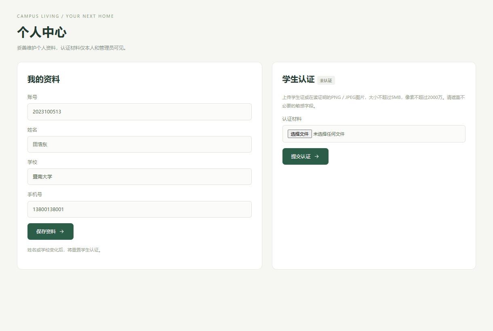


## 四 文件与交付清单

| 交付内容 | 位置 | 用途 |
| --- | --- | --- |
| 完整应用源代码 | src与pom.xml | 重新编译和继续开发 |
| 可运行JAR与启动脚本 | dist与启动项目.cmd | Windows本机运行、连接Kali |
| 数据库设计 | schema.sql与数据库部署.sql | 表结构、约束和初始化 |
| 测试源代码 | src/test/java | 复现规则、业务及性能测试 |
| 浏览器测试脚本 | scripts/ui-smoke.cjs | 界面流程、截图和移动视口验证 |
| 设计源图及图片 | docs/diagrams | 编辑和重生成UML模型 |
| 测试证据 | docs/evidence与docs/test-reports | 自动化结果、截图、覆盖率和恢复记录 |
| 运行与维护文档 | README与Kali部署与备份.md | 本机启动、数据库切换、备份恢复 |
| 实验汇总报告 | 软件工程-实验报告汇总版.docx | 10项实验的设计、过程与结果 |

## 五 当前限制与后续改进

Kali MariaDB已完成页面流程验证；真实数据库并发与长期运行仍需另行测试。当前验证以Chrome桌面及手机视口为主，没有宣称完成所有主流浏览器矩阵。性能测试是一次明确负载下的本机测量，真实部署还需要长期观测、备份恢复演练和容量评估。

合同为意向与线下签约记录，不提供电子签章或在线支付；房源图片和地址为演示资料，不构成真实房产信息。密码恢复采用离线保存的密钥，丢失密钥时需要受控的管理员核验流程，未接入短信。管理列表当前显示最近1000条、审计显示最近200条；更大规模应用应增加后台分页与专门的审计归档。

后续可优先将区域与户型改成实体外键、将大型控制器按模块进一步拆分、增加真实MySQL持续集成环境和文件清理策略，再评估房东角色、对象存储、HTTPS、电子签章与地图服务。每项扩展应先补需求与验收口径，再修改数据模型和测试。

## 六 综合体会

本次实践中最有价值的工作是把抽象要求转为不可绕过的业务约束：学生不能通过接口发布房源，待审内容不能经列表泄露，同一时段不能有两个有效占位，旧会话不能在密码重置后继续使用，备份必须能实际恢复。界面、数据库和测试需要对同一组规则给出一致结果。

完整的软件工程交付不仅是程序能够启动，还需要可重建的源码、可解释的设计、可复查的缺陷和测试证据。报告中的环境限制、模拟过程与未验收事项均明确说明，使后续继续开发和课程审阅能够依据事实进行。

## 七 参考资料

[1] 田浩东 租房信息管理系统 软件需求规格说明书 V1.0 2026年9月30日 项目本地原始资料。

[2] 软件工程 实验报告1和2 与实验报告汇总模板 项目本地课程资料。

[3] Spring Boot Reference System Requirements https://docs.spring.io/spring-boot/3.5/system-requirements.html 访问日期2026年10月24日。

[4] Spring PetClinic 官方示例 https://github.com/spring-projects/spring-petclinic 访问日期2026年10月24日。仅作为分层设计的学习参考，没有复制其业务代码。

[5] Spring Framework JDBC文档 https://docs.spring.io/spring-framework/reference/data-access/jdbc.html。

[6] PlantUML官方语言参考 https://plantuml.com/zh/guide。

[7] JUnit 5 User Guide https://junit.org/junit5/docs/current/user-guide/。

[8] JaCoCo Maven Plugin https://www.jacoco.org/jacoco/trunk/doc/maven.html。
